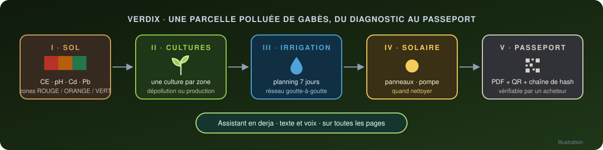
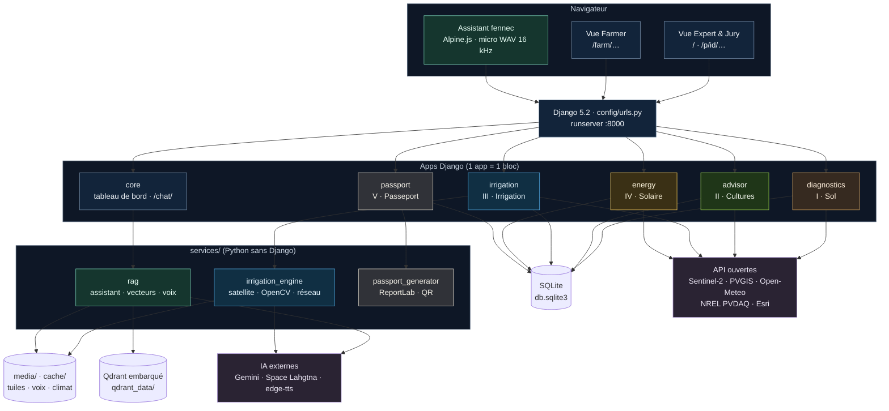
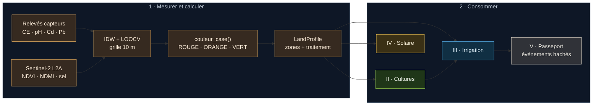
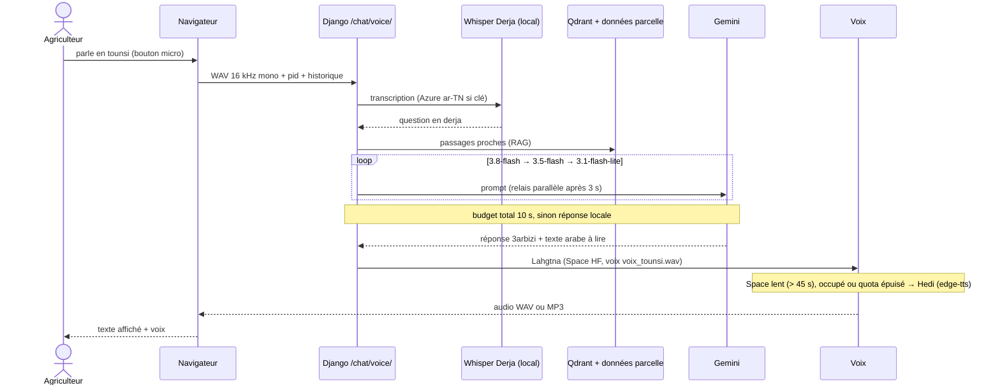

<div align="center">
  
  <h1>Verdix · Gabès</h1>
  <p><strong>Du sol pollué au passeport vérifiable.</strong></p>
  <p>Diagnostic du sol, cultures, irrigation goutte-à-goutte solaire et passeport QR<br/>pour une parcelle polluée de Gabès, avec un assistant qui parle derja.</p>
  
</div>

<div align="center">

[](requirements.txt)
[](requirements.txt)
[](.env.example)
[](services/rag/vecteurs.py)
[](#vérification)

[Explorer](#cinq-étapes-pour-une-parcelle) · [Architecture](#architecture) · [Lancer en local](#lancer-en-local) · [Vérification](#vérification) · [Documentation](#documentation)

</div>

---

**Verdix** répond à trois questions sur une parcelle polluée de Gabès : **où le sol est-il contaminé ?**, **que planter, combien arroser et avec quelle énergie solaire ?** et **comment prouver le traitement à un acheteur ?** C'est une réécriture en Django du prototype Streamlit « Gabès Regenerate » (hackathon eau · énergie · agriculture), dans le dépôt `kizuna-regenerate`.

Les calculs viennent de données ouvertes réelles : **Sentinel-2** (Earth Search), **PVGIS v5.3**, **Open-Meteo**, **NREL PVDAQ** et **LUCAS Heavy Metals**, avec des formules FAO-56 et une interpolation IDW validée par LOOCV. Les relevés de sol des parcelles de démo et la production des panneaux sans capteur ESP32 sont **simulés**, et l'écran le signale. Gemini **rédige** des explications et des consignes ; il ne remplace pas les calculs. **L'application ne commande aucune vanne ni aucune pompe réelle** : le mode automatique est une simulation jour par jour.

## Cinq étapes pour une parcelle

| Étape | Page | Ce que l'on peut faire |
| :--- | :--- | :--- |
| **I · Sol** (`diagnostics`) | `/p/<id>/diagnostic/` | Plan des capteurs, relevés CE · pH · Cd · Pb, carte IDW, zones **ROUGE / ORANGE / VERT**, traitement par zone, couche Sentinel-2 |
| **II · Cultures** (`advisor`) | `/p/<id>/crops/` | Terre nue ou déjà plantée, une culture par zone, score d'une plantation, plan PNG |
| **III · Irrigation** (`irrigation`) | `/p/<id>/irrigation/` | Planning 7 jours, validation → automatique / manuel, agent d'irrigation, réseau goutte-à-goutte sur image satellite |
| **IV · Solaire** (`energy`) | `/p/<id>/solar/` | Nombre de panneaux, pompe et réservoir ; 3 IA (production, cause d'une baisse, date de nettoyage) ; alertes |
| **V · Passeport** (`passport`) | `/p/<id>/passport/` | PDF + QR + chaîne de hash, page publique `/verify/<id>/` |
| **Assistant** (`core`, `services/rag`) | toutes les pages | Questions en derja (texte ou micro), réponses en 3arbizi lues avec l'accent tunisien |
| **Vue Farmer** (`farmer`) | `/farm/` | Les mêmes données et actions en phrases courtes et gros chiffres : Water, Soil, Plants, Sun, Certificate |

Deux interfaces partagent la même logique et les mêmes données : la vue **Expert & Jury** (`/`, toutes les données, cartes, modèles et sources) et la vue **Farmer** (`/farm/`). Chaque page renvoie vers la page équivalente de l'autre vue pour la même parcelle. Trois parcelles de démo sont fournies : **GAB-001** (Chenini Oasis Plot), **GAB-002** (Ghannouch Coastal Field) et **GAB-003** (Mareth Olive Grove).

### Un parcours rapide

1. **Sol** — ouvrir `/demo/` (parcelle GAB-001) ou créer une parcelle sur `/parcels/new/` (position GPS + hectares), relever ou simuler les capteurs, lancer le diagnostic.
2. **Cultures** — choisir « terre nue » ou « déjà plantée » ; chaque zone reçoit une culture et deux alternatives.
3. **Irrigation** — valider le planning, passer en automatique, puis « Simuler la journée suivante ». La page `network/` trace le réseau goutte-à-goutte sur l'image satellite ou sur une photo envoyée.
4. **Solaire** — lire le dimensionnement et l'alerte de nettoyage ; « I cleaned the panels today » remet le compteur à zéro.
5. **Passeport** — télécharger le PDF et scanner le QR ; `/verify/GAB-001-P4-T/` montre un passeport falsifié (« Tampered »).
6. **Assistant** — cliquer sur le fennec, demander « Kifech ns9i lyoum? » ou parler avec le bouton micro.

> **Les preuves d'abord.** Une zone VERT n'est pas une certification sanitaire : le satellite ne mesure **jamais** Cd ni Pb, et la couleur vient des relevés de la parcelle. Un passeport « Verified » prouve que la chaîne d'événements n'a pas été modifiée, pas que le sol est propre. Une réponse de l'assistant reformule les données de la parcelle ; elle ne remplace ni une analyse de laboratoire ni un agronome.

## Architecture

### L'application et ses services



Le schéma est logique : tout tourne dans **un seul processus Django** (port **8000** par défaut). Qdrant fonctionne en mode embarqué dans `qdrant_data/`, sans serveur. Les seuls appels réseau sont les API ouvertes, Gemini, le Space Hugging Face de la voix et edge-tts ; chacun a un repli hors ligne ou local.

| Frontière | Responsabilité réelle |
| :--- | :--- |
| `templates/` + `static/js/app.js` | Interface sans build (Tailwind CDN, Alpine.js, HTMX, Leaflet, Chart.js) ; aucun calcul métier |
| Apps Django | Vues, modèles, formulaires ; chaque app appelle ses fonctions de `*/services/` via `*/logic.py` |
| `services/` | Calculs purs : seuils, traitement, cultures, moteur de réseau, RAG, PDF ; testables sans Django |
| `fixtures/` | Parcelles de démo, contrat LandProfile, métriques des modèles, caches satellite et météo pour la démo hors ligne |
| API externes | Données ouvertes et IA ; jamais indispensables à l'affichage d'une page |

### Le contrat entre les blocs : LandProfile



Le bloc 1 produit un **LandProfile** ; les autres blocs le lisent. Exemple complet (grille 3×3, 3 zones) : [`fixtures/land_profile.sample.json`](fixtures/land_profile.sample.json).

```python
from diagnostics.contract import load_sample   # ou latest_for(parcel)
profile = load_sample()
```

- **Une seule fonction couleur** : `diagnostics.couleur.couleur_case(ce, ph, cd, pb)`. Ne pas la recopier.
- Valeurs en **MAJUSCULES** : `ROUGE` / `ORANGE` / `VERT`, `NUE` / `PLANTEE`, etc.
- Ne pas changer les clés du contrat sans prévenir toute l'équipe. Champs facultatifs du bloc 1 : `confiance`, `interpolation`, `satellite`, `fusion_ce`, `points_controle`, `cases[].satellite`, `zones[].observations`, `tri_labo`, `releves_simules`.

### L'assistant vocal en derja



Ordre d'écoute : **Azure ar-TN** (si clé) → **Whisper Derja** local (`faster-whisper`, hors ligne) → Gemini audio. Ordre de voix : **Azure** (si clé) → **Lahgtna** (Space `AVOiD/derja-tts`, GPU gratuit, imite [`services/rag/voix_tounsi.wav`](services/rag/voix_tounsi.wav)) → **Hedi** (`ar-TN-HediNeural`, edge-tts). Les WAV Lahgtna sont gardés dans `media/voix/cache/` : relire une réponse ne consomme pas de quota. Le navigateur abandonne une question écrite après **18 s** ; l'assistant reconnaît aussi localement des commandes (« ouvre l'irrigation », « simule la journée suivante ») et les questions météo ou pompe du jour (« chnowa ta9es »). Code : [`services/rag/`](services/rag/), [`core/chat_controls.py`](core/chat_controls.py), [`core/chat_conditions.py`](core/chat_conditions.py).

### Comportement sans clé ou hors ligne

| Bloc | Repli |
| :--- | :--- |
| **Sol** | Satellite des parcelles de démo en cache (`fixtures/bloc1/satellite/`) ; sans modèle Cd entraîné, pas de tri labo |
| **Cultures** | Climat Open-Meteo → NASA POWER → `advisor/data/regions.json` ; sans Gemini, pas de comptage des plantes sur photo |
| **Irrigation** | Météo 7 jours → moyennes du climat ; imagerie Esri sans clé ; consignes de l'agent sans rédaction Gemini |
| **Solaire** | Sans `.joblib` (`energy_train`), replis physiques (PVWatts) et règles |
| **Assistant** | Sans Gemini : passages retrouvés (« Gemini indisponible ») ; embeddings locaux (n-grammes) ; voix Hedi |

### Les blocs en détail

<details>
<summary><strong>I · Sol — plan des capteurs, IDW, modèle Cd, Sentinel-2</strong></summary>

- **Plan des capteurs** : jusqu'à 1 ha, max(5, surface / 400 m²) points ; au-delà, 25 + 1 point par 0,25 ha. Terre de 20 ha au plus.
- **IDW** : puissance choisie par validation croisée (LOOCV), confiance selon la distance au relevé le plus proche.
- **Modèle Cd** (`python manage.py bloc1_train_cd <HeavyMetals.xlsx>`) : risque Cd ≥ 1 mg/kg à partir d'un relevé XRF (LUCAS Heavy Metals 2009, ESDAC). **AUC 0,84** en découpage aléatoire, **0,737** sur 5 219 sols méditerranéens ([`fixtures/bloc1/modele_cd_metriques.json`](fixtures/bloc1/modele_cd_metriques.json)). Le `.joblib` n'est pas versionné.
- `bloc1_experiment` : erreur IDW selon le nombre de points ([`fixtures/bloc1/experience_capteurs.json`](fixtures/bloc1/experience_capteurs.json)). `bloc1_extract_lucas <LUCAS_TOPSOIL_v1.xlsx>` : sols méditerranéens calcaires.
- **Sentinel-2 L2A** (Earth Search, sans compte) : NDVI, NDMI et indice de sel de surface par case de 10 m. Il sert à une fusion « régression + IDW des résidus » pour la **CE**, adoptée seulement si la validation croisée gagne ≥ 10 % et |r| ≥ 0,5, à des observations par zone et à des points de contrôle. `bloc1_satellite [ids…]` met le résultat en cache pour la démo. Attribution : « Contains modified Copernicus Sentinel data ».
- Notebook : [`notebooks/bloc1_modele.ipynb`](notebooks/bloc1_modele.ipynb) (données via `LUCAS_HM_XLSX`).

</details>

<details>
<summary><strong>II · Cultures — une culture par zone</strong></summary>

- **ROUGE / ORANGE** : plantes et microbes du `traitement` du bloc 1 ; secours Atriplex + hyperaccumulatrice. ROUGE : pas de lessivage (LR = 0) et collecte du drainage.
- **VERT** : **une seule culture par zone** (une vanne = mêmes besoins en eau), évaluée avec la CE **max** de la zone et le climat, + 2 alternatives. `culture_alimentaire_autorisee = false` → jamais d'alimentaire.
- Terre nue ou plantée : choix de l'agriculteur, sinon détectée par Sentinel-2 (`advisor/services/etat_terre.py`).
- Base de plantes : `advisor/data/plantes.json` (ajouter une plante = copier un bloc).
- JSON : `GET /p/<id>/crops/recommandation.json` · plan PNG : `GET /p/<id>/crops/plan/`.

</details>

<details>
<summary><strong>III · Irrigation — planning, agent, réseau goutte-à-goutte</strong></summary>

- Météo 7 jours Open-Meteo (ET0, pluie, rayonnement horaire ; cache 1 h). Besoin par zone et par jour = formule FAO du bloc 2 ; arrosage à 6 h en 1 à 3 doses selon la texture.
- Pluie ≥ 5 mm → arrosage annulé (raison affichée). Le quota de nappe hebdomadaire n'est jamais dépassé : priorité VERT → ORANGE → ROUGE, chaque réduction est expliquée.
- Pompage nappe → réservoir seulement quand le soleil suffit ; le réservoir ne déborde jamais. Paramètres dans l'admin : **Paramètres d'irrigation**.
- Planning en base (`IrrigationPlan`, `IrrigationEvent`, `ValveState`, `SoilMoistureReading`, `ValveEvent`). Parcours : **Valider → Automatique → Simuler la journée suivante / Manuel**, **Modifier un volume**, **Nouveau planning** (`POST /p/<id>/irrigation/reset/`).
- **Agent d'irrigation** : consignes du jour et de la semaine, rédigées par Gemini si la clé est présente.
- **Réseau goutte-à-goutte** (`/p/<id>/irrigation/network/`) : le moteur `services/irrigation_engine/` télécharge l'image satellite (`esri` par défaut, `google` ou `mapbox`), détecte les plantes en place (Gemini Vision si activé) et trace conduite principale, porte-rampes, rampes et goutteurs. Option photo vue du dessus + 4 coins. Arbres épars : réseau arbre par arbre, sans arbres inventés. Résultat : `DripNetworkPlan` (image, GeoJSON, bilan m³/an).
- JSON : `plan.json`, `etat.json`, `agent.json`, `passeport.json`, `network/api/`, `network/geojson/`.

</details>

<details>
<summary><strong>IV · Solaire — dimensionnement et 3 IA</strong></summary>

- **Dimensionnement** : nombre de plantes → eau mois par mois (FAO-56, ET0 Open-Meteo ERA5) → énergie de pompage `E = 0,002725 · V · H / η` avec `H = (profondeur + 10) × 1,1` et `η = 0,45` → panneaux de 450 W, pompe, réservoir. Mois dimensionnant : juillet, marge salissure 5 %. Production du lieu : **PVGIS v5.3**.
- **IA 1** production attendue de panneaux propres, entraînée sur de vraies données **NREL PVDAQ** (2010-2012, test 2013) : erreur journalière **1,1 %** contre 1,6 % pour la formule PVWatts ([`fixtures/energy/ia1_metriques.json`](fixtures/energy/ia1_metriques.json)).
- **IA 2** cause d'une baisse (propre / poussière / panne) : **97,2 %** d'exactitude, **2,5 %** de fausses alertes ([`fixtures/energy/ia2_metriques.json`](fixtures/energy/ia2_metriques.json)).
- **IA 3** date de nettoyage avec poussière et pluie prévues : erreur médiane **3 jours** ([`notebooks/solaire_ia.ipynb`](notebooks/solaire_ia.ipynb)).
- **ESP32** : `POST /api/energy/<id>/readings/` `{"mesures": [{"t": "...", "w": 410, "poa": 850, "t_air": 22}]}`. Sans capteur, la production est simulée sur la vraie météo des 45 derniers jours (signalé à l'écran).

</details>

<details>
<summary><strong>V · Passeport — chaîne de hash et QR</strong></summary>

- `hash_n = sha256(hash_{n-1} + JSON canonique de l'événement)`, PDF ReportLab + QR (`services/passport_generator.py`).
- Page publique `/verify/<id>/`, lisible par un acheteur ; `/verify/GAB-001-P4-T/` montre un passeport falsifié.

</details>

## Lancer en local

**Prérequis** : **Python 3.11**, Windows PowerShell (macOS / Linux : mêmes commandes avec `python3` et `source .venv/bin/activate`). Aucun compte n'est nécessaire pour la démo.

```powershell
.\.venv\Scripts\python.exe manage.py runserver
```

Ouvrir **[http://127.0.0.1:8000/](http://127.0.0.1:8000/)** (vue Expert & Jury) ou **[http://127.0.0.1:8000/farm/](http://127.0.0.1:8000/farm/)** (vue Farmer). Le serveur de développement recharge le code à chaque modification ; il ne télécharge ni modèle ni données au démarrage. Le modèle Whisper Derja (~250 Mo) est téléchargé au premier message vocal.

<details>
<summary><strong>Première installation</strong></summary>

```powershell
py -3.11 -m venv .venv
.\.venv\Scripts\Activate.ps1
pip install -r requirements.txt
Copy-Item .env.example .env      # puis remplir les clés facultatives
python manage.py migrate
python manage.py energy_train    # IA du volet solaire (sinon replis physiques)
python manage.py createsuperuser # admin : /admin/
```

</details>

<details>
<summary><strong>Ouvrir depuis un téléphone (QR, micro)</strong></summary>

```powershell
python manage.py runserver 0.0.0.0:8000
```

Ajouter l'adresse IP du PC dans `ALLOWED_HOSTS` (`.env`), puis ouvrir `http://<IP>:8000/` sur le téléphone (même Wi-Fi). Le navigateur n'autorise le **micro** que sur `localhost` ou en HTTPS : par adresse IP, l'assistant reste utilisable au clavier.

</details>

### Ports et adresses

| Service | Port local | Route d'entrée ou de contrôle |
| :--- | :---: | :--- |
| Django (`runserver`) | 8000 | `/` · `/farm/` · `/admin/` |
| Qdrant serveur (facultatif, `QDRANT_URL`) | 6333 | vide = mode embarqué `qdrant_data/` |
| Page publique du passeport | 8000 | `/verify/<passport_id>/` |
| API capteurs ESP32 | 8000 | `POST /api/energy/<id>/readings/` |

## Configuration

Les réglages viennent de `.env` (copié depuis [`.env.example`](.env.example), jamais commité), sinon des valeurs par défaut de [`config/settings.py`](config/settings.py). Les clés restent côté serveur ; le navigateur ne voit que la clé Google Maps « navigateur » facultative.

| Réglage | Rôle |
| :--- | :--- |
| `DJANGO_SECRET_KEY`, `DEBUG`, `ALLOWED_HOSTS` | Django (valeurs de développement par défaut) |
| `GEMINI_API_KEY`, `GEMINI_MODEL` | Assistant, agent d'irrigation, photo des plantes ; défaut `gemini-3.8-flash` |
| `GEMINI_MODELES_SECOURS`, `GEMINI_MODEL_VOIX` | Modèles de relais (`gemini-3.5-flash`, `gemini-3.1-flash-lite`) et modèle de la voix (`gemini-3.5-flash`) |
| `GEMINI_EMBED_MODEL` | Embeddings du RAG (sinon n-grammes locaux) |
| `QDRANT_URL`, `QDRANT_API_KEY` | Serveur Qdrant (vide = embarqué) |
| `WHISPER_DERJA_MODEL` | Écoute hors ligne ; défaut `TheBiggyBang/whisper-small-tunisian-derja-ct2` |
| `VOIX_LAHGTNA`, `HF_TOKEN`, `VOIX_LAHGTNA_DELAI_S` | Voix à l'accent tunisien (Space Hugging Face, délai 45 s) |
| `VOIX_REFERENCE`, `VOIX_REFERENCE_TEXTE` | Autre voix à imiter (vide = `services/rag/voix_tounsi.wav`) |
| `VOIX_EDGE_TTS`, `AZURE_TTS_VOICE` | Voix de secours Hedi / Reem (edge-tts, sans clé) |
| `AZURE_SPEECH_KEY`, `AZURE_SPEECH_REGION`, `AZURE_STT_LANGUAGE` | Azure Speech facultatif (ar-TN), prioritaire s'il est configuré |
| `CHAT_ECRITURE` | `arabizi` (défaut), `arabe` ou `meme` : écriture des réponses |
| `GOOGLE_MAPS_API_KEY`, `GOOGLE_MAPS_BROWSER_KEY`, `SATELLITE_FOURNISSEUR`, `SATELLITE_ZOOM`, `MAPBOX_TOKEN` | Imagerie du réseau goutte-à-goutte (Esri sans clé par défaut) |
| `DETECTION_IA` | Détection des plantes par Gemini Vision (`True` par défaut) |

> **Quotas gratuits.** Le 2026-11-22, l'offre gratuite Gemini limitait `gemini-3.8-flash` à **20 requêtes par jour et par projet Google** : une nouvelle clé du même projet n'ajoute pas de quota. Le GPU gratuit du Space Lahgtna a un quota quotidien **par compte Hugging Face** ; une fois épuisé, la voix passe à Hedi pendant 30 min. L'assistant reste utilisable sans aucune clé.

## Données locales et fichiers persistants

| Fichier local | Ce qui persiste |
| :--- | :--- |
| `db.sqlite3` | Parcelles, relevés, plannings, événements d'irrigation, passeports |
| `qdrant_data/` | Base vectorielle de l'assistant (reconstruite si absente) |
| `media/` | Photos envoyées, tuiles satellite (`tiles_cache/`), voix générées (`voix/cache/`) |
| `cache/` | Climat Open-Meteo / NASA POWER |
| `*.joblib`, `*.pkl` | Modèles entraînés (`energy_train`, `bloc1_train_cd`) ; `water_model.pkl` fait 107 Mo, au-delà de la limite GitHub |
| `.env` | Clés API et réglages locaux |

Aucun de ces fichiers n'est commité (voir [`.gitignore`](.gitignore)). Les clés restent dans `.env`, jamais dans le code. Licences : le modèle Lahgtna est publié sous licence MIT ; `voix_tounsi.wav` a été généré par ce modèle à partir d'une référence edge-tts, dont les conditions d'usage ne sont pas documentées ici. La provenance du modèle 3D `static/fennec.glb` n'est pas documentée dans ce dépôt.

## Vérification

Le **2026-11-22**, la suite de tests enregistrée sur `main` compte **129 tests, tous réussis** (`Ran 129 tests … OK`, 21 s). C'est un contrôle de non-régression, pas une mesure de couverture ni une certification. Les tests n'appellent ni Gemini, ni Hugging Face, ni Internet : les services externes sont simulés.

| Vérification | Résultat enregistré | Commande |
| :--- | :--- | :--- |
| Tout le projet | **129 réussis** | `python manage.py test` |
| `core` (tableau de bord, assistant, voix) | **28** | `python manage.py test core` |
| `diagnostics` | **24** | `python manage.py test diagnostics` |
| `advisor` | **19** | `python manage.py test advisor` |
| `irrigation` (faux serveur de tuiles) | **38** | `python manage.py test irrigation` |
| `energy` | **15** | `python manage.py test energy` |
| `farmer` | **5** | `python manage.py test farmer` |

```powershell
python manage.py check
python manage.py test
```

Il n'y a pas encore de workflow d'intégration continue : les tests se lancent à la main avant chaque fusion dans `main`.

## Limites

- **Sol** : la couleur dépend des relevés ; les parcelles de démo utilisent des relevés simulés. Le satellite ne mesure ni Cd ni Pb. Le modèle Cd sert au tri avant laboratoire, pas au diagnostic.
- **Cultures et irrigation** : besoins FAO-56 et météo de prévision ; aucune mesure d'humidité réelle sans capteur. Le mode automatique est simulé jour par jour.
- **Solaire** : sans ESP32, la production est simulée sur la météo réelle ; les IA sont entraînées sur des panneaux américains (NREL PVDAQ).
- **Assistant** : dépend des quotas gratuits de Gemini et du Space Lahgtna ; les réponses peuvent se tromper et renvoient vers les pages de la parcelle.
- **Dans tout le projet** : aucune commande de matériel, aucune authentification des agriculteurs, aucune affiliation avec les fournisseurs de données. Le passeport prouve l'intégrité d'une chaîne d'événements, pas la qualité du sol.

## Carte du dépôt

```text
kizuna-regenerate/
├── config/            réglages Django, URL racines
├── core/              tableau de bord, textes de l'interface, assistant (/chat/, /chat/voice/, /chat/tts/)
├── diagnostics/       I · Sol : capteurs, IDW, zones, Sentinel-2, modèle Cd
├── advisor/           II · Cultures : recommandations par zone, score, plan PNG
├── irrigation/        III · Irrigation : planning 7 jours, agent, réseau goutte-à-goutte
├── energy/            IV · Solaire : dimensionnement, 3 IA, alertes, API ESP32
├── passport/          V · Passeport : PDF, QR, vérification publique
├── farmer/            vue Farmer : vues minces, aucune logique propre
├── services/          calculs sans Django : seuils, traitement, cultures, irrigation_engine, rag, PDF
├── templates/         pages et composants (zone_badge, kpi_card, gauge, modal…)
├── static/            app.js, app.css (thème forêt · citron vert · menthe), fennec 3D
├── fixtures/          parcelles de démo, LandProfile, métriques, caches satellite et météo
├── notebooks/         modèle Cd (bloc 1), IA solaires
├── design-system/     règles visuelles Farmer et Expert
└── docs/assets/       logo et illustration du README
```

### Branches

| App | Branche | Rôle |
| :--- | :--- | :--- |
| `core` | `main` | `Parcel`, `PollutionSource`, tableau de bord, textes, assistant |
| `diagnostics` | `bloc-1` | Diagnostic du sol |
| `advisor` | `bloc-2` | Conseiller cultures |
| `irrigation` | `bloc-3`, `bloc-3.4` | Planning, réseau goutte-à-goutte, agent, assistant vocal |
| `energy` | `energy` | Volet solaire |
| `passport` | `bloc-4` | Passeport et vérification |
| `farmer` | `ui-v2` | Vue Farmer |

```powershell
git checkout bloc-1          # votre branche
git pull origin main         # récupérer les changements communs
git push origin bloc-1
```

Fusion dans `main` par pull request, après `python manage.py test`.

## Documentation

| À lire ensuite | Ce que ça explique |
| :--- | :--- |
| [`fixtures/land_profile.sample.json`](fixtures/land_profile.sample.json) | Le contrat LandProfile complet entre les blocs |
| [`design-system/kizuna/MASTER.md`](design-system/kizuna/MASTER.md) | Couleurs, typographie, règles d'accessibilité communes |
| [`design-system/kizuna/pages/farmer.md`](design-system/kizuna/pages/farmer.md) · [`expert.md`](design-system/kizuna/pages/expert.md) | Choix visuels des deux vues |
| [`notebooks/bloc1_modele.ipynb`](notebooks/bloc1_modele.ipynb) | Modèle de risque Cd et expériences IDW |
| [`notebooks/solaire_ia.ipynb`](notebooks/solaire_ia.ipynb) | Entraînement et validation des 3 IA solaires |
| [`.env.example`](.env.example) | Tous les réglages, avec leurs valeurs par défaut |
| [`services/rag/`](services/rag/) | Assistant RAG, écoute et voix en derja |

Le code et ce README font foi ; `services/` contient aussi du code repris de l'ancien prototype Streamlit (`seuils.py`, `traitement.py`, `cultures.py`, `passport_generator.py`), non repris : `app.py` Streamlit, LUCAS/NIR, `auth.py`, `llm_agent.py`.
